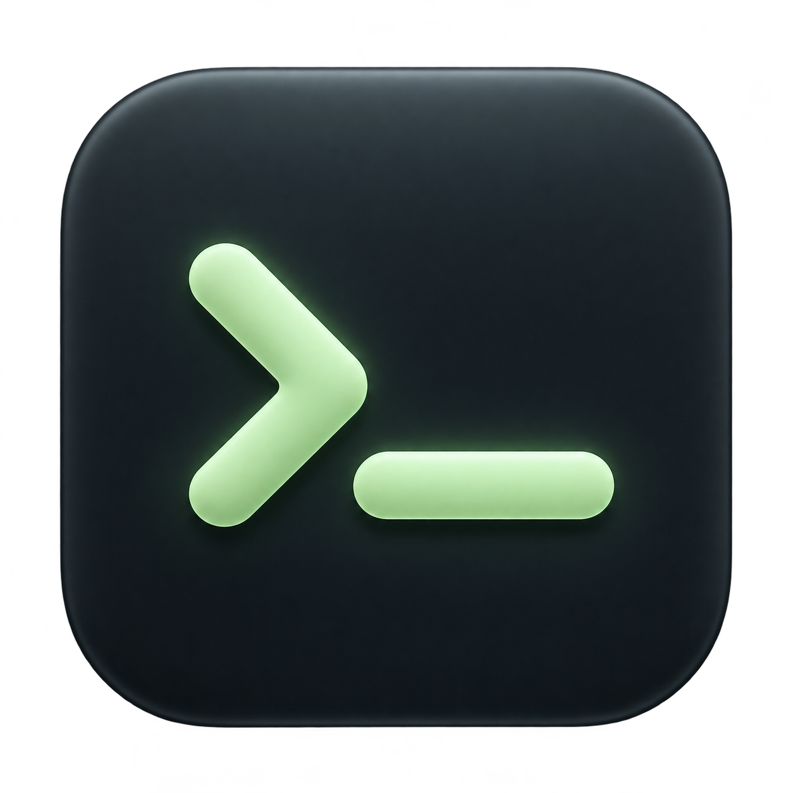

# Soothe

A macOS USB serial console built with Electron, Node SerialPort, and Coder's Ghostty Web. Ghostty's WebAssembly terminal parser handles ANSI output. SerialPort opens the device directly; no shell or PTY intermediary is needed.

## Run

Use Node.js 24 or newer and npm.

```sh
npm install
npm start
```

`npm start` builds the renderer and opens the desktop application. `npm run dev` previews the UI in a browser; USB discovery and log saving require the Electron app. Demo mode works in either.

## Connect an M5Stack Atom

1. Connect the Atom using a USB **data** cable.
2. Click refresh in the device sidebar. Select its USB serial port. On macOS, Soothe uses the `/dev/cu.*` callout device when available.
3. Start with **115200 baud**, 8 data bits, no parity, 1 stop bit, and no flow control. Choose the baud rate configured by your firmware if different.
4. Click **Connect to device**. Firmware output appears in the console. The firmware needs to emit serial data; a quiet console does not necessarily indicate a connection problem.
5. Type directly in the terminal for interactive consoles, or use the command field with CR + LF, LF, CR, or no line ending. Commands depend on the firmware installed on the device.
6. Disconnect before flashing firmware or opening the port in another app.

If no USB port appears, try another data cable and USB port. Some Atom Lite systems need an FTDI VCP driver, as described in the [M5Stack documentation](https://docs.m5stack.com/en/core/ATOM%20Lite). Garbled text usually means the firmware and console baud rates differ. A port-busy error can mean another serial monitor owns the port. Opening a serial port may toggle control lines and reset some boards; Soothe does not provide an explicit reset or flashing action.

## Console behavior

- A single active serial session, with explicit connect and disconnect.
- Device discovery on startup and through Refresh. Unplugging updates the connection state; reconnection is manual.
- Incoming LF-only newlines return to column one for display. Existing CRLF and standalone carriage returns are preserved, including across USB reads. Saved logs and RX counts retain the original received data. The line-ending selector controls outgoing commands only.
- ANSI rendering, terminal keyboard input, selectable command line endings, RX/TX counters, and 10,000 lines of terminal scrollback.
- Copy log copies the same received session text to the clipboard. Save log exports received UTF-8 text, including ANSI escape sequences. The in-memory log retains the latest 4 million characters. Clear removes terminal scrollback; it does not erase the session log. A new connection starts a new log.
- Demo mode is labeled and never opens a physical port.
- Sandboxed renderer, context isolation, restricted IPC, no remote content, and no renderer Node access.

## Checks and local packaging

```sh
npm test             # serial lifecycle, byte integrity, validation, open failure recovery
npm run test:desktop # opens and closes a real Electron window; tests demo only
npm run package      # unsigned local .app under release/mac-arm64 or release/mac
```

The desktop test checks Ghostty initialization, native port discovery, command input, demo disconnection, and renderer isolation. It does not open hardware ports. Physical Atom communication has not yet been verified.

The generated app is for local use. Distribution requires your Apple signing identity and notarization. The native serial dependency is rebuilt by electron-builder for the packaged Electron version.

## References

- [Ghostty Web](https://github.com/coder/ghostty-web), a Coder project using Ghostty's parser, rather than the native Ghostty macOS view.
- [Node SerialPort](https://serialport.io/docs/api-stream/)
- [Electron security guidance](https://www.electronjs.org/docs/latest/tutorial/security)

## Code quality

Biome uses the current rules from `/Users/mez/dev/fin/biome.json`, with generated-output exclusions adapted for this app. It enforces two-space indentation, a 120-column line width, function expressions and arrows, concise arrow returns, braces around control flow, and no non-null assertions.

```sh
npm run format       # apply safe Biome fixes
npm run check        # Biome, then Fallow with findings treated as failures
npm run typecheck    # TypeScript compiler checks
npm test             # unit tests, no device or GUI needed
npm run mutate       # Stryker; requires a 100% mutation score
```

Fallow checks unused code and dependencies, duplication, and complexity. Electron's main process, preload, renderer, and test scripts are explicit entry points. Generated bundles, packaged apps, reports, and mutation sandboxes are excluded. No baseline hides existing findings.

Stryker mutates `electron/serial.cjs` and `src/received-newlines.mts`. It uses the command runner with `npm test`, which runs the Node test suite against each mutation. Tests use fake serial ports and never open hardware. Electron IPC and renderer UI are outside this initial mutation scope; the desktop smoke test covers startup and demo interaction separately. Add new device-independent logic to the mutation scope when it is introduced.

Mutation reports are written to `reports/mutation/mutation.html` and `reports/mutation/mutation.json`. Stryker's command runner reports the entire test invocation as one test and cannot provide per-test coverage. The threshold still checks every selected mutation. The sandbox excludes `tsconfig.json` because native Node TypeScript tests do not use it; `npm run typecheck` remains a separate required check.

## CI

GitHub Actions runs on pull requests and pushes to `main`, and can be started manually. All jobs use Node 24 and `npm ci` with the committed lockfile.

- **Code quality, tests and build** runs Biome, Fallow, unit tests, TypeScript checking, and the Vite build on Linux.
- **Mutation testing** enforces the 100% score and uploads HTML/JSON reports, including on failure.
- **macOS desktop and packaging** runs the Electron demo smoke test and builds the unsigned app. It never opens a hardware port. Desktop screenshots are uploaded for review.

Reports are retained for 14 days. A new run cancels an older run on the same branch. The workflow needs no repository secrets and has read-only repository permissions. Branch protection is configured separately in GitHub if these checks should block merges.
